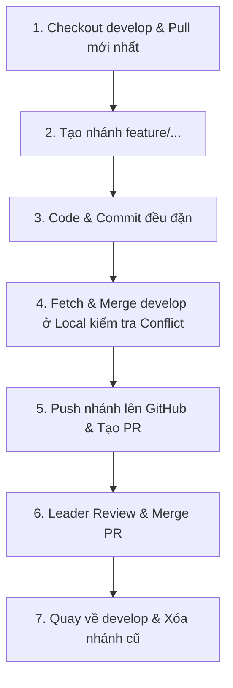

# 🌿 CẨM NANG QUY TRÌNH GIT & PHỐI HỢP NHÓM (GIT WORKFLOW GUIDE)

> **Dự án:** Cloud-Based Banking Data Warehouse & Analytics Platform  
> **Tài liệu dành cho:** Thành viên nhóm phát triển (Data Engineers & Big Data Developers) 
> **Mục tiêu:** Chuẩn hóa quy trình làm việc từ lúc nhận Task, tạo Branch, Commit, Test Conflict ở Local đến khi tạo Pull Request (PR) và Merge code an toàn.

---

## 📑 MỤC LỤC
1. [Kiến trúc phân nhánh (Branching Strategy)](#1-kiến-trúc-phân-nhánh-branching-strategy)
2. [Quy trình 6 bước làm việc chuẩn (Standard 6-Step Workflow)](#2-quy-trình-6-bước-làm-việc-chuẩn)
3. [Giải mã thuật ngữ & Câu lệnh cốt lõi (`origin`, `-u`, `fetch` vs `pull`)](#3-giải-mã-thuật-ngữ--câu-lệnh-cốt-lõi)
4. [Bản chất Pull Request & Tại sao phải kiểm tra Local trước?](#4-bản-chất-pull-request--tại-sao-phải-kiểm-tra-local-trước)
5. [Quy ước đặt tên Commit (Conventional Commits)](#5-quy-ước-đặt-tên-commit-conventional-commits)
6. [Bảng tra cứu nhanh các câu lệnh thường dùng (Cheat Sheet)](#6-bảng-tra-cứu-nhanh-các-câu-lệnh-cheat-sheet)

---

## 1. KIẾN TRÚC PHÂN NHÁNH (Branching Strategy)

Hệ thống Git của dự án được tổ chức theo mô hình **Git Feature Branch Workflow**:

```
[main]       ──────────────────────────────────────────────▶ (Production / Demo ổn định)
               ▲
               │ (Merge khi kết thúc Sprint tuần)
[develop]    ──┴─────┬─────────────┬─────────────┬─────────▶ (Nhánh TÍCH HỢP CHUNG của cả nhóm)
                     │             ▲             ▲
                     │ (Tạo branch)│             │
[feature/*]          └─────────────┴─── (PR) ────┘           (Nhánh làm việc của từng cá nhân)
```

- **`main`**: Nhánh bảo vệ, chỉ chứa code đã hoàn thiện, kiểm thử đầy đủ. Tuyệt đối không commit trực tiếp.
- **`develop`**: Nhánh trung tâm tích hợp toàn bộ tính năng của cả team. Mọi nhánh `feature` đều tách ra từ đây và gộp lại về đây.
- **`feature/<Mã-Task>-<mô-tả-ngắn>`**: Nhánh độc lập của từng thành viên làm 1 task cụ thể.
  - *Ví dụ:* `feature/DE-01-setup-bigdata-docker-stack`, `feature/DE-02-aws-s3-credentials`, `feature/BD-02-mapreduce-mapper`.

---

## 2. QUY TRÌNH 6 BƯỚC LÀM VIỆC CHUẨN



### 🔹 Bước 1: Bắt đầu Task mới
Luôn bắt đầu từ code mới nhất của `develop`:
```powershell
# Chuyển về develop
git checkout develop

# Kéo code mới nhất mà các thành viên khác vừa merge
git pull origin develop

# Tạo nhánh feature mới và chuyển sang nhánh đó
git checkout -b feature/DE-02-aws-s3-credentials
```

---

### 🔹 Bước 2: Viết Code & Commit thường xuyên
Chia nhỏ công việc và commit rõ ràng theo từng phần hoàn chỉnh:
```powershell
# Kiểm tra file đã chỉnh sửa
git status

# Thêm file muốn commit (Lưu ý: Không commit .env hoặc file dữ liệu lớn)
git add dags/utils/s3_helper.py

# Commit kèm thông điệp chuẩn
git commit -m "feat(ingest): add s3 upload helper using boto3"
```

---

### 🔹 Bước 3: Đồng bộ với `develop` và Kiểm tra Xung đột (Conflict) tại Local
Trước khi đẩy code, hãy kiểm tra xem trong lúc bạn code có ai vừa đưa code mới lên `develop` không:
```powershell
# Cập nhật thông tin mới nhất từ GitHub
git fetch origin

# Gộp develop vào nhánh feature của bạn để kiểm tra
git merge origin/develop
```
- **Nếu không có conflict:** Git báo `Already up to date` hoặc tự động merge thành công.
- **Nếu có conflict:** Mở VS Code giải quyết xung đột, lưu file, gõ `git add .` và `git commit -m "chore: resolve merge conflict with develop"`.

---

### 🔹 Bước 4: Đẩy nhánh lên GitHub (Push)
```powershell
# Đẩy nhánh lên remote và thiết lập theo dõi mặc định (-u)
git push -u origin feature/DE-02-aws-s3-credentials
```

---

### 🔹 Bước 5: Tạo Pull Request (PR) trên GitHub
1. Vào GitHub repo của dự án: [Cloud-Based-Banking-Data-Warehouse-Analytics-Platform](https://github.com/GrayNguyen-Data/Cloud-Based-Banking-Data-Warehouse-Analytics-Platform)
2. Bấm nút **`Compare & pull request`**.
3. Chọn:
   - **Base:** `develop` ⬅ **Compare:** `feature/DE-02-aws-s3-credentials`
4. Viết mô tả PR (Task ID, nội dung thay đổi, kết quả test).
5. Gán Reviewer (Leader hoặc đồng đội) để kiểm tra code.

---

### 🔹 Bước 6: Merge PR & Dọn dẹp nhánh Local
Khi Leader đã **Approve** và **Merge PR** vào `develop`:
```powershell
# Chuyển về nhánh develop trên máy bạn
git checkout develop

# Kéo code mới nhất (đã có tính năng bạn vừa làm)
git pull origin develop

# Xóa nhánh feature cũ ở local
git branch -d feature/DE-02-aws-s3-credentials
```

---

## 3. GIẢI MÃ THUẬT NGỮ & CÂU LỆNH CỐT LÕI

### 🌐 `origin` là gì?
`origin` là **biệt danh (alias / nickname)** của đường link URL kho chứa GitHub từ xa.  
Thay vì phải gõ toàn bộ URL dài dòng:
`git push https://github.com/GrayNguyen-Data/Cloud-Based-Banking-Data-Warehouse-Analytics-Platform.git feature/DE-01`  
Git rút gọn lại thành:  
`git push origin feature/DE-01`

### 🔗 Cờ `-u` (`--set-upstream`) là gì?
Khi bạn đẩy một nhánh mới toanh lên GitHub lần đầu tiên, GitHub chưa biết nhánh ở máy bạn liên kết với nhánh nào trên mây.  
- **Cờ `-u`** giúp Git **thiết lập mối quan hệ ghép đôi mặc định** giữa nhánh local và remote.
- **Lợi ích:** Từ lần thứ 2 trở đi, bạn **không cần gõ tên nhánh nữa**, chỉ cần gõ đúng 2 chữ:  
  `git push` hoặc `git pull`.

$$\text{git push} \quad \underbrace{\mathbf{-u}}_{\text{Ghi nhớ liên kết}} \quad \underbrace{\mathbf{origin}}_{\text{Lên kho GitHub}} \quad \underbrace{\mathbf{feature/DE-01}}_{\text{Vào nhánh này}}$$

### 🔄 Phân biệt `git fetch` vs `git pull`

| Tiêu chí | `git fetch origin` | `git pull origin develop` |
|---|---|---|
| **Bản chất** | Tải thông tin/commit mới của **TẤT CẢ các nhánh** về máy | Tải code và **GỘP THẲNG vào nhánh hiện tại** |
| **Công thức** | `git fetch` | $\text{git pull} = \text{git fetch} + \text{git merge}$ |
| **Ảnh hưởng code?** | ❌ **Không sửa đổi bất kỳ file code nào** | ✅ Có thay đổi file code trong thư mục làm việc |
| **Mức độ an toàn** | An toàn 100% (dùng để kiểm tra trước) | Có thể sinh ra conflict nếu có sửa chung dòng |

---

## 4. BẢN CHẤT PULL REQUEST & TẠI SAO PHẢI KIỂM TRA LOCAL TRƯỚC?

### Hai chiều chuyển động của code:

1. **Chiều 1: Kiểm tra ở Local (`develop` ➔ `feature`)**
   - Chạy lệnh: `git merge origin/develop`
   - *Mục đích:* Kéo code của người khác về nhánh mình để xem có bị xung đột không. Nhánh `develop` trên GitHub **chưa hề thay đổi**.
2. **Chiều 2: Tạo Pull Request (`feature` ➔ `develop`)**
   - Tạo trên Web GitHub.
   - *Mục đích:* Đưa tính năng của bạn vào kho chung cho toàn team sử dụng sau khi đã được Leader thẩm định chất lượng.

---

## 5. QUY ƯỚC ĐẶT TÊN COMMIT (Conventional Commits)

Cú pháp chuẩn: `<loại_commit>(<phạm_vi>): <mô tả ngắn gọn bằng tiếng Anh hoặc tiếng Việt>`

| Loại Commit | Mục đích sử dụng | Ví dụ thực tế |
|---|---|---|
| **`feat:`** | Thêm tính năng, module, service mới | `feat(docker): add hive metastore and hiveserver2` |
| **`fix:`** | Sửa lỗi hoặc xử lý bug | `fix(hive): resolve metastore schema auto-creation` |
| **`docs:`** | Viết tài liệu, báo cáo, cập nhật README | `docs(report): add DE-01 technical report` |
| **`refactor:`** | Tái cấu trúc / dọn dẹp code (không đổi tính năng) | `refactor(env): move database credentials to .env` |
| **`chore:`** | Cập nhật `.gitignore`, dependencies, file cấu hình | `chore(git): ignore sensitive credentials and data` |

---

## 6. BẢNG TRA CỨU NHANH CÁC CÂU LỆNH (Cheat Sheet)

```powershell
# 1. Bắt đầu task
git checkout develop
git pull origin develop
git checkout -b feature/<task-name>

# 2. Lưu trạng thái làm việc
git status
git add .
git commit -m "feat(scope): message"

# 3. Kiểm tra trước khi nộp
git fetch origin
git merge origin/develop

# 4. Đẩy code lên GitHub
git push -u origin feature/<task-name>
# Các lần sau chỉ cần:
git push

# 5. Dọn dẹp sau khi PR được merge
git checkout develop
git pull origin develop
git branch -d feature/<task-name>
```
